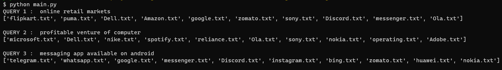

# مدل بازیابی و رتبه‌بندی اسناد

**Information Retrieval · Inverted Index · TF-IDF · Boolean Search**

[English version](README.md)

این پروژه یک سیستم ساده بازیابی اطلاعات با پایتون است که روی **۴۱ سند متنی انگلیسی** کار می‌کند. کاربر می‌تواند یک عبارت معمولی برای جست‌وجوی رتبه‌بندی‌شده وارد کند یا با عملگرهای بولی مشخص کند کدام سندها در نتیجه نمایش داده شوند.

## امکانات

- پیش‌پردازش متن شامل Tokenization، حذف کلمات توقف و Lemmatization
- ساخت و استفاده از Inverted Index و Posting List
- محاسبه وزن کلمات با TF-IDF
- جست‌وجوی بولی با `AND`، `OR`، `+` و `NOT`
- پشتیبانی از پرانتز در عبارت‌های بولی
- نمایش حداکثر ۱۰ سند در جست‌وجوی رتبه‌بندی‌شده معمولی

## نمونه جست‌وجو

بعد از اجرای `main.py` عبارت موردنظر در ترمینال وارد می‌شود.

| عبارت | نتیجه موردنظر |
| --- | --- |
| `sport + line` | سندهایی که sport **یا** line دارند |
| `sport OR line` | معادل عملگر `+` |
| `sport AND line` | سندهایی که **هر دو** کلمه را دارند |
| `sport NOT line` | سندهایی که sport دارند ولی line ندارند |
| `sport AND NOT line` | معادل عبارت قبلی |
| `NOT sport` | سندهایی که sport ندارند |
| `(sport + line) AND NOT technology` | ترکیب چند شرط با پرانتز |
| `online retail markets` | جست‌وجوی معمولی همراه با رتبه‌بندی |

**اولویت عملگرها:** ابتدا `NOT`، سپس `AND` و در آخر `OR` یا `+`. در جست‌وجوی بولی، نام تمام فایل‌های منطبق نمایش داده می‌شود؛ در جست‌وجوی معمولی، حداکثر ۱۰ نتیجه بر اساس امتیاز ارتباط مرتب می‌شوند.

نمونه خروجی:

```text
Enter your query: sport AND line
QUERY 1 :  sport AND line
['nike.txt', 'yahoo.txt']
```



نمونه عبارت‌های بیشتر در [`examples/sample_queries.txt`](examples/sample_queries.txt) قرار دارند.

## ساختار پروژه

```text
Rank-Retrieval-Model/
├── main.py                  # دریافت عبارت جست‌وجو
├── PreprocessQuery.py       # پیش‌پردازش عبارت
├── CosineSimilarity.py      # یافتن و امتیازدهی اسناد
├── PostingList.py           # ایندکس و لیست ارسال
├── Lemmatizer.py            # ریشه‌یابی لغوی
├── Stopwords.py             # کلمات توقف
├── tfidf.py                 # وزن‌دهی کلمات
├── Dataset/                 # اسناد متنی
├── Indexes/                 # ایندکس‌های ذخیره‌شده
├── tfidf_weights/           # وزن‌های محاسبه‌شده
├── Output/                  # تصویر نمونه خروجی
├── examples/                # عبارت‌های نمونه
├── tests/                   # تست جست‌وجوی بولی
├── docs/                    # توضیحات تکمیلی
├── requirements.txt
├── README.md
└── README.fa.md
```

## نصب و اجرا

پایتون نسخه ۳.۱۰ تا ۳.۱۲ پیشنهاد می‌شود. در پوشه پروژه دستورهای زیر را وارد کنید:

```bash
python -m pip install -r requirements.txt
python -m spacy download en_core_web_sm
python -m nltk.downloader stopwords punkt punkt_tab wordnet omw-1.4 averaged_perceptron_tagger averaged_perceptron_tagger_eng
```

در صورت تمایل می‌توان کتابخانه‌ها را داخل محیط مجازی نصب کرد. در ویندوز می‌توان به‌جای `python` از `py` استفاده کرد.

اجرای برنامه:

```bash
python main.py
```

اجرای تست‌های عملگرهای بولی:

```bash
python -m unittest discover -s tests -v
```

نصب کتابخانه‌ها و منابع زبانی به اینترنت نیاز دارد، اما فایل‌های دیتاست و ایندکس در همین پروژه موجودند.

## نکات فنی

جست‌وجوی بولی بر اساس وجود کلمه در سند است و جست‌وجوی عبارت دقیق (Exact Phrase Search) نیست. بخش رتبه‌بندی از فرمول وزن‌دهی و امتیازدهی پیاده‌سازی‌شده در کد استفاده می‌کند و با یک مجموعه ارزیابی استاندارد سنجیده نشده است. همچنین فایل‌های ایندکس ذخیره‌شده باید از منبع قابل‌اعتماد باشند.

مجوز بازنشر اسناد متنی مشخص نیست. پیش از انتشار عمومی دیتاست، [`docs/DATASET_AND_PUBLICATION.md`](docs/DATASET_AND_PUBLICATION.md) را بررسی کنید.
