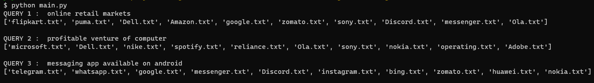

# Rank & Retrieval Model

**A Python information-retrieval project with document indexing, query preprocessing, Boolean search, and TF-IDF-based document ranking.**

[Read in Persian / نسخه فارسی](README.fa.md)

## Overview

This project was developed as an information-retrieval course project. It searches a small collection of English text documents and returns matching document names. It includes two query modes:

- **Boolean retrieval:** use `+` (OR), `AND`, `NOT`, and parentheses to filter documents. Boolean results include *all* matching document names rather than a top-10 ranking.
- **Ranked retrieval:** for a regular query without Boolean operators, the program uses its original TF-IDF-based weighting and similarity-scoring implementation to return up to 10 documents.

The program contains **41 text documents** and saved index/weight files. This repository keeps the existing Python implementation, including the earlier Boolean-search fixes, unchanged.

## Features

- Tokenization, English stopword handling, and lemmatization with NLTK and spaCy
- Inverted index and document ID mapping
- TF-IDF-based document and query weighting
- Document retrieval with the project's original similarity-scoring code
- Boolean expressions (`+`, `OR`, `AND`, `NOT`) with parentheses
- A text-based query interface

## Project structure

```text
Rank-Retrieval-Model/
├── main.py                     # Query entry point
├── PreprocessQuery.py          # Query preprocessing and Boolean operators
├── CosineSimilarity.py         # Boolean matching and ranked retrieval
├── PostingList.py              # Posting list and file index
├── Lemmatizer.py               # Word lemmatization
├── Stopwords.py                # Stopword handling
├── tfidf.py                    # Term weights and query weights
├── Dataset/                    # 41 English documents
├── Indexes/                    # Existing inverted index and file index
├── tfidf_weights/              # Existing TF-IDF weights
├── Output/                     # Original sample output screenshot
├── examples/                   # Example queries
├── tests/                      # Boolean logic checks (no source code changes)
├── docs/                       # Original README and publication notes
├── BOOLEAN_SEARCH_GUIDE.txt   # Guide included in the fixed project
├── requirements.txt
├── README.fa.md                # Persian README
└── README.md                   # This file
```

## Installation

**Recommended:** Python 3.10–3.12. The project uses NLTK and spaCy plus English language resources.

1. Clone the repository and open its directory:

   ```bash
   git clone https://github.com/YOUR_USERNAME/Rank-Retrieval-Model.git
   cd Rank-Retrieval-Model
   ```

   Replace `YOUR_USERNAME` with your own GitHub username. You can also download the repository as a ZIP and extract it.

2. Create and activate a virtual environment:

   **Windows (PowerShell):**

   ```powershell
   py -m venv .venv
   .\.venv\Scripts\python.exe -m pip install -r requirements.txt
   ```

   **Linux / macOS:**

   ```bash
   python3 -m venv .venv
   source .venv/bin/activate
   python -m pip install -r requirements.txt
   ```

3. Download the English spaCy model and NLTK resources:

   ```bash
   python -m spacy download en_core_web_sm
   python -m nltk.downloader stopwords punkt punkt_tab wordnet omw-1.4 averaged_perceptron_tagger averaged_perceptron_tagger_eng
   ```

   On Windows, if you did not activate the virtual environment, run the commands with `.\.venv\Scripts\python.exe` instead of `python`.

   The extra NLTK data names cover differences across NLTK versions. Downloads require an internet connection during setup.

## Run

From the repository's **root directory**, run:

```bash
python main.py
```

Enter a query when prompted:

```text
Enter your query: sport AND line
QUERY 1 :  sport AND line
['nike.txt', 'yahoo.txt']
```

### Boolean operators

| Input | Meaning | Number of matches in the included index |
| --- | --- | ---: |
| `sport + line` | Sport **OR** line | 20 |
| `sport OR line` | Same as `+` | 20 |
| `sport AND line` | Contains **both** terms | 2 |
| `sport NOT line` | Contains sport but **not** line | 3 |
| `sport AND NOT line` | Same as the previous expression | 3 |
| `NOT sport` | Documents **without** sport | 36 |
| `(sport + line) AND NOT technology` | Combined expression | 7 |

**Precedence:** `NOT` → `AND` → `+` / `OR`; use parentheses to group expressions. Queries are interpreted against the saved index. Matching is based on normalized terms, not exact phrases. Boolean results are ordered by document ID and are **not** relevance-ranked.

For ordinary ranked retrieval, try `online retail markets` (no Boolean operators). The program returns up to 10 document names based on its original scoring implementation.

See [examples/sample_queries.txt](examples/sample_queries.txt) for more inputs.

## Original example output

The image below was included with the original course project. It shows example outputs from its ranked-search mode, not the revised Boolean-search mode.



## Tests

An additional lightweight test file checks the Boolean matching logic using the saved term index, without changing any existing `.py` source file:

```bash
python -m unittest discover -s tests -v
```

The checks do not replace a full end-to-end run; a full run requires the NLTK resources and spaCy English model listed above.

## Notes and limitations

- The **original ranking implementation** has been retained. The scoring and normalization have not been independently validated as a standard cosine-similarity implementation.
- Boolean queries retrieve matching documents; they are **not trained machine-learning classifiers**.
- Precomputed index/weight files are provided to preserve the original project behavior. Run only files from sources you trust: the original program uses `eval()` when loading some saved files.
- The repository is a course-scale demonstration rather than a production search engine. It does not include relevance judgments or benchmark scores such as MAP/MRR.
- Dataset/document rights have not been independently verified; see [publication notes](docs/DATASET_AND_PUBLICATION.md) before publishing the repository publicly.

## Code preservation

The seven original project `.py` files are kept **byte-for-byte identical** to the previously Boolean-fixed version. GitHub documentation, setup metadata, sample queries, and optional tests have been added separately. The original `readme.md` is retained as [docs/original_readme.md](docs/original_readme.md).
